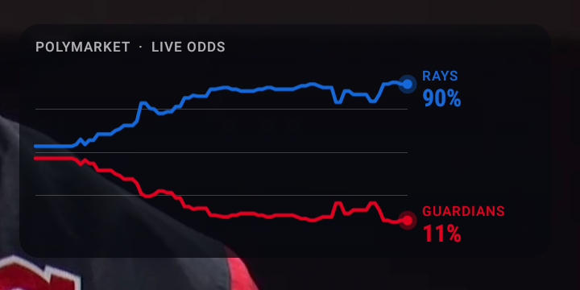

# Poly Odds

Live [Polymarket](https://polymarket.com) win-probability chart overlaid on whatever you're watching on a **Fire TV, Nvidia Shield, or any Android/Google TV box**: TiviMate, YouTube TV, Sling, anything.



## Features

- **Works on Fire TV** (tested on a Fire TV Stick 4K, Fire OS 6 / Android 7.1) as well as Shield and Google TV (Android 11+). Runs on Android 5.1 and later.
- **Any player app.** It's a system overlay, so it works over TiviMate and other IPTV players, not just one streaming app.
- **Tick-level prices** from Polymarket's CLOB websocket (best bid/ask midpoint), with REST polling as a fallback.
- **Phone remote** at `http://<tv-ip>:8765`: pick games, set delay, move or resize, and hide the overlay without leaving the stream.
- **Broadcast-delay sync** (0–300 s) so price moves line up with the play on screen. IPTV is often 20–60 s behind live.
- **Soccer three-way markets:** home, away and draw lines. Also NFL, college football, NBA, MLB, NHL, college basketball, WNBA, EPL, Champions League, MLS, LaLiga, Bundesliga, Serie A and Ligue 1.
- **Team colours** from Polymarket, brightened so they read over video. Pulsing endpoints, odometer-style rolling % digits, and a fixed clock-grid chart that doesn't shimmer as the window grows.
- **Auto-detect (Shield / Google TV):** an accessibility service reads on-screen channel and programme titles, such as TiviMate's banner ("MLB 01: Rays vs Guardians (TBS)"), and switches to that game. Screens that list several games, like the guide, are ignored. *Not available on Fire TV: Amazon blocks third-party accessibility services.*
- **Restarts after reboot.** ~75 KB, no dependencies, no Gradle.

## Install

Turn on **ADB debugging** on the TV.
- Fire TV: Settings → My Fire TV → About → click the device name 7 times, then Developer options → ADB debugging.
- Android/Google TV: Settings → Device Preferences → About → click Build 7 times, then Developer options → USB debugging.

Then, from a computer on the same network:

```sh
./install.sh <tv-ip>
```

Or do it by hand with the APK from [Releases](../../releases):

```sh
adb connect <tv-ip>:5555
adb install PolyOdds.apk
adb shell appops set app.polyodds SYSTEM_ALERT_WINDOW allow     # draw over other apps (hidden setting on TV)
# optional, Shield/Google TV only: auto-detect. Append to the existing list rather than replacing it:
adb shell settings put secure enabled_accessibility_services app.polyodds/app.polyodds.DetectService
```

Accept the "Allow USB debugging?" prompt on the TV the first time.

## Use

- **On the TV:** open Poly Odds and pick a game. It drops you back into TiviMate with the chart up. The same menu has delay, position, size, auto-detect and hide.
- **From your phone:** open `http://<tv-ip>:8765`. The address is also shown in the TV menu.
- **Tuning the delay:** wait for a big play. If the chart moves before the TV shows it, add delay; if it moves after, remove some.

## Build

Plain Java, built straight with the SDK tools (aapt2 → javac → d8 → zipalign → apksigner):

```sh
./build.sh
```

The script assumes WSL with the Android SDK at `%LOCALAPPDATA%\Android\Sdk` (build-tools 36.1, platform 34) and Android Studio's bundled JDK. Edit the paths at the top for other setups. It generates a local `debug.keystore` on first run.

## How it works

```
Gamma API  /events?series_id=…  (stream-parsed: NFL pages are 15–40 MB of prop markets)
   │  games, team names, colours, CLOB token ids
   ▼
OverlayService ── /prices-history (backfill from kickoff − 15 min)
   │            └─ wss://ws-subscriptions-clob.polymarket.com/ws/market  (book + price_changes → midpoint)
   │               falls back to /midpoint polling
   ├─ ControlServer :8765   phone page + /api/state, /api/games, /api/pick, /api/set, /api/hide
   ├─ DetectService         accessibility text → game matcher (both teams named in one text node)
   └─ ChartView             TYPE_APPLICATION_OVERLAY, non-focusable; delayed cutoff = now − delay
```

| File | What |
|---|---|
| `Game.java` | league list, streaming Gamma parser, team colours, on-screen matching |
| `OverlayService.java` | overlay window, price feed, settings, detection |
| `ChartView.java` | chart, pulse, odometer labels |
| `WsClient.java` | ~120-line RFC 6455 client |
| `ControlServer.java` + `assets/control.html` | phone remote |
| `DetectService.java` | accessibility service (auto-detect) |
| `MainActivity.java` | TV menu |

Debug: `adb logcat -s polyodds`. Test the matcher with `curl "http://<tv-ip>:8765/api/detect?text=MLB%2001:%20Rays%20vs%20Guardians"`.

## Notes

- Prices are Polymarket's global CLOB midpoints. A mid is ignored when the spread is wider than 10¢, as Polymarket's own UI does.
- The phone page has no authentication. Anyone on your Wi-Fi can change what's shown, and that's all it can do.
- Not affiliated with Polymarket.
